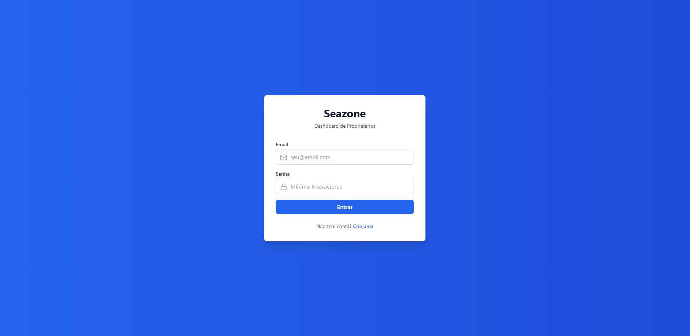
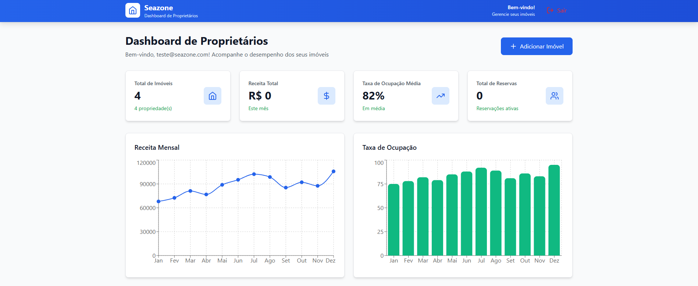
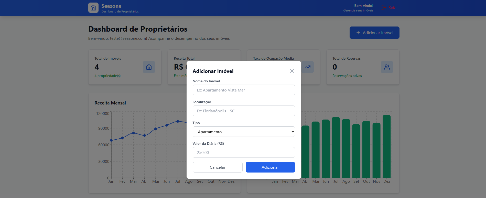

# 🏠 Seazone Dashboard - Gerenciamento de Imóveis

Um **dashboard profissional** para proprietários gerenciarem suas propriedades de temporada em tempo real.

Desenvolvido para o hackathon de seleção da **Seazone**.

---

## 🎯 Features Principais

✅ **Autenticação Segura** - Login/Signup com Supabase Auth  
✅ **Dashboard Completo** - Cards de estatísticas e gráficos  
✅ **Gerenciamento de Imóveis** - Adicione e visualize suas propriedades  
✅ **Banco de Dados Real** - Dados persistem com Supabase  
✅ **Design Responsivo** - Funciona em mobile, tablet e desktop  
✅ **Deploy ao Vivo** - Rodando na Vercel  

---

## 🌐 Demo

**Acesse agora:** [https://seazone-dashboard.vercel.app/](https://seazone-dashboard.vercel.app/)

**Teste com:**
- Email: `teste@seazone.com`
- Senha: `teste123`

Já vem com 4 imóveis de exemplo pré-configurados!

**Ou crie sua própria conta** clicando em "Crie uma".

---

## 📸 Screenshots

### Tela de Login


### Dashboard Principal


### Adicionar Imóvel


---

## 💻 Tech Stack

### Frontend
- **Next.js 14** - Framework React moderno
- **React 18** - UI components
- **TypeScript** - Type safety
- **Tailwind CSS** - Styling
- **Recharts** - Gráficos interativos
- **Lucide React** - Ícones

### Backend & Database
- **Supabase** - Auth + Database (PostgreSQL)
- **Supabase Auth** - Autenticação segura
- **PostgreSQL** - Banco de dados relacional

### Deployment
- **Vercel** - Hosting do frontend
- **Supabase Cloud** - Hosting do backend

---

## 🚀 Como Rodar Localmente

### Pré-requisitos
- Node.js 16+
- npm ou yarn
- Git

### Instalação

1. **Clone o repositório:**
```bash
git clone https://github.com/MarcusMichelin/seazone-dashboard.git
cd seazone-dashboard
```

2. **Instale as dependências:**
```bash
npm install
```

3. **Configure as variáveis de ambiente:**

Crie um arquivo `.env.local` na raiz do projeto:

NEXT_PUBLIC_SUPABASE_URL=sua_url_aqui
NEXT_PUBLIC_SUPABASE_ANON_KEY=sua_chave_aqui

(Obtenha essas chaves no [Supabase](https://supabase.com))

4. **Execute o servidor de desenvolvimento:**
```bash
npm run dev
```

5. **Abra no navegador:**
http://localhost:3000

---

## 📊 Estrutura do Projeto

seazone-dashboard/
├── src/
│ ├── app/
│ │ ├── layout.tsx # Layout raiz
│ │ └── page.tsx # Dashboard principal
│ ├── components/
│ │ ├── Auth.tsx # Componente de login
│ │ ├── Header.tsx # Cabeçalho
│ │ ├── StatCard.tsx # Cards de estatísticas
│ │ ├── RevenueChart.tsx # Gráfico de receita
│ │ ├── OccupancyChart.tsx # Gráfico de ocupação
│ │ ├── PropertiesTable.tsx # Tabela de imóveis
│ │ ├── ReservationsTable.tsx # Tabela de reservas
│ │ ├── AddPropertyForm.tsx # Formulário de novo imóvel
│ │ ├── LogoutButton.tsx # Botão de logout
│ │ └── Header.tsx # Header com logout
│ ├── data/
│ │ └── mockData.ts # Dados simulados
│ ├── lib/
│ │ └── supabase.ts # Configuração Supabase
│ └── styles/
│ └── globals.css # Estilos globais
├── package.json
├── tsconfig.json
├── tailwind.config.js
└── README.md

---

## 🎨 Funcionalidades em Detalhes

### 📱 Autenticação
- Signup com email/senha
- Login seguro
- Sessão persistente
- Logout

### 🏠 Dashboard
- **Cards de Estatísticas:**
  - Total de imóveis
  - Receita total
  - Taxa de ocupação média
  - Total de reservas

- **Gráficos:**
  - Receita mensal (linha)
  - Taxa de ocupação (barras)

- **Tabelas:**
  - Lista de propriedades do usuário
  - Histórico de reservas

### ➕ Adicionar Imóvel
- Formulário modal
- Campos: nome, localização, tipo, valor diário
- Salva automaticamente no Supabase
- Aparece na tabela em tempo real

---

## 🔐 Segurança

- ✅ RLS (Row Level Security) ativado no Supabase
- ✅ Cada usuário vê apenas seus próprios dados
- ✅ Autenticação com JWT
- ✅ Chaves de API protegidas no `.env.local`

---

## 📈 Roadmap (Próximas Features)

- [ ] Editar/deletar imóveis
- [ ] Gerenciar reservas
- [ ] Dashboard de análises avançado
- [ ] Exportar relatórios (PDF/Excel)
- [ ] Notificações de novas reservas
- [ ] Integração com calendário
- [ ] Dark mode
- [ ] Múltiplos idiomas

---

## 🛠️ Como Contribuir

1. Fork o projeto
2. Crie uma branch para sua feature (`git checkout -b feature/AmazingFeature`)
3. Commit suas mudanças (`git commit -m 'Add some AmazingFeature'`)
4. Push para a branch (`git push origin feature/AmazingFeature`)
5. Abra um Pull Request

---

## 📝 Licença

Este projeto está sob licença MIT. Veja o arquivo LICENSE para mais detalhes.

---

## 👤 Autor

**Marcus Michelin**

- GitHub: [@MarcusMichelin](https://github.com/MarcusMichelin)
- Email: marcusmichelin@gmail.com

---

## 🙏 Agradecimentos

- Seazone pelo inspiring
- Supabase pela excelente plataforma
- Vercel pelo melhor deploy
- React, Next.js e comunidade open source

---

## 📞 Suporte

Se tiver dúvidas, abra uma **Issue** no GitHub!

---

**⭐ Se este projeto foi útil, deixe uma star! ⭐**
